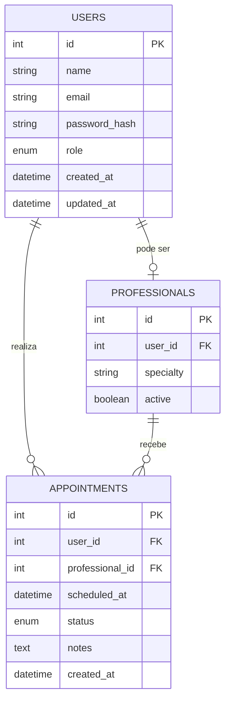

# ⚙️ DPP — Parte 4: Backend
> **[NOME DO PROJETO]** — Versão `1.0` | Status: `Em Elaboração`

> 🧭 **Responsável por este arquivo:** Assessores de Desenvolvimento · **Valida:** Gerente de Desenvolvimento (DER revisado pelo Tech Lead)
> 🌿 **Branch de preenchimento:** `dpp/<ano>-<cliente>/backend` (ver `MANUAL-GIT.md`)
>
> 🔗 **Referências cruzadas:** as especificações referenciam funcionalidades (`F0X`) e regras de negócio (`RN-00X`) definidas em `produto/01-produto.md`. A tabela de endpoints de cada spec é o **contrato** consumido por `desenvolvimento/05-frontend.md` — preencha os endpoints (método, rota, auth) o quanto antes, mesmo que o detalhamento venha depois.

---

## 📌 Sumário

1. [Modelagem do Banco de Dados](#1-modelagem-do-banco-de-dados)
2. [Especificação Técnica por Funcionalidade](#2-especificação-técnica-por-funcionalidade)
3. [Requisitos Não Funcionais de Backend](#3-requisitos-não-funcionais-de-backend)
4. [Riscos Técnicos e Dependências Externas](#4-riscos-técnicos-e-dependências-externas)

---

## 1. Modelagem do Banco de Dados

> Esta seção descreve a estrutura de dados do sistema. Deve ser consistente com as funcionalidades e regras de negócio documentadas em `produto/01-produto.md`.

### 1.1 Diagrama Entidade-Relacionamento (DER)

> Insira aqui o diagrama ER. Recomenda-se usar Mermaid (compatível com GitHub/GitLab) ou imagem exportada do dbdiagram.io / draw.io.



> ⚠️ *Substitua o diagrama acima pelo modelo real do seu projeto.*

---

### 1.2 Dicionário de Dados

> Documente cada tabela com seus campos, tipos e regras.

#### Tabela: `users`

| Campo            | Tipo          | Obrigatório | Padrão    | Descrição                              |
|-----------------|---------------|-------------|-----------|----------------------------------------|
| `id`            | INT (PK)      | Sim         | AUTO_INC  | Identificador único                    |
| `name`          | VARCHAR(100)  | Sim         | —         | Nome completo do usuário               |
| `email`         | VARCHAR(255)  | Sim         | —         | E-mail único, usado para login         |
| `password_hash` | VARCHAR(255)  | Sim         | —         | Senha criptografada (bcrypt)           |
| `role`          | ENUM          | Sim         | `user`    | Papel: `admin`, `operator`, `user`     |
| `active`        | BOOLEAN       | Sim         | `true`    | Indica se o usuário está ativo         |
| `created_at`    | DATETIME      | Sim         | NOW()     | Data de criação                        |
| `updated_at`    | DATETIME      | Sim         | NOW()     | Data da última atualização             |

**Restrições:**
- `email` deve ser único na tabela
- `role` aceita apenas os valores: `admin`, `operator`, `user`

---

#### Tabela: `[nome_tabela]`

| Campo     | Tipo    | Obrigatório | Padrão | Descrição |
|-----------|---------|-------------|--------|-----------|
| `id`      | INT(PK) | Sim         | AUTO_INC | [...]   |
| `[campo]` | [tipo]  | [Sim/Não]   | [—]    | [...]     |

**Restrições:**
- [...]

> ➕ *Repita o bloco acima para cada tabela do banco de dados.*

---

### 1.3 Convenções do Banco de Dados

| Convenção              | Padrão adotado                                      |
|------------------------|-----------------------------------------------------|
| Nomenclatura de tabelas | `snake_case`, plural (ex: `users`, `appointments`) |
| Nomenclatura de colunas | `snake_case` (ex: `created_at`, `user_id`)         |
| Chaves estrangeiras     | `[tabela_referenciada]_id` (ex: `user_id`)         |
| Timestamps              | Todas as tabelas terão `created_at` e `updated_at` |
| Soft delete             | [Usar `deleted_at` / Não usar — justifique]        |
| Encoding                | UTF-8 / utf8mb4                                    |

---

## 2. Especificação Técnica por Funcionalidade

> Esta seção descreve **como** cada funcionalidade será implementada no backend. É o bridge entre o documento de Produto e o código. Todas as funcionalidades **P0 e P1** devem ter especificação.

---

### Spec: F01 — [Nome da Funcionalidade]

**Endpoint(s) envolvidos:**

| Método | Rota                   | Descrição                       | Auth?  |
|--------|------------------------|---------------------------------|--------|
| POST   | `/api/auth/login`      | Autentica o usuário             | Não    |
| POST   | `/api/auth/logout`     | Encerra a sessão                | Sim    |

**Request Body (Exemplo):**
```json
{
  "email": "usuario@email.com",
  "password": "minhasenha123"
}
```

**Response de Sucesso (200):**
```json
{
  "token": "eyJhbGciOiJIUzI1NiIs...",
  "user": {
    "id": 1,
    "name": "João Silva",
    "role": "admin"
  }
}
```

**Respostas de Erro:**

| Status | Código de Erro       | Quando ocorre                          |
|--------|----------------------|----------------------------------------|
| 400    | `INVALID_BODY`       | Body da requisição inválido ou ausente |
| 401    | `INVALID_CREDENTIALS`| E-mail ou senha incorretos             |
| 403    | `USER_INACTIVE`      | Usuário desativado no sistema          |
| 500    | `SERVER_ERROR`       | Erro interno inesperado                |

**Lógica de negócio (backend):**
1. Validar campos obrigatórios (`email`, `password`)
2. Buscar usuário pelo `email` na tabela `users`
3. Verificar se `active = true`
4. Comparar `password` com `password_hash` via bcrypt
5. Gerar token JWT com payload `{ id, role, email }`
6. Retornar token e dados públicos do usuário

**Tabelas acessadas:** `users`

**Regras de negócio aplicadas:** RN-001, RN-002

---

### Spec: F02 — [Nome da Funcionalidade]

**Endpoint(s) envolvidos:**

| Método | Rota        | Descrição  | Auth? |
|--------|-------------|------------|-------|
| [...]  | [...]       | [...]      | [..] |

**Request Body:**
```json
{}
```

**Response de Sucesso:**
```json
{}
```

**Lógica de negócio (backend):**
1. [Passo 1]
2. [Passo 2]

**Tabelas acessadas:** [...]

**Regras de negócio aplicadas:** [...]

> ➕ *Repita o bloco acima para cada funcionalidade que envolva lógica de backend.*

---

## 3. Requisitos Não Funcionais de Backend

> Definem **como** o backend deve se comportar — qualidade, performance, segurança e disponibilidade. Requisitos de compatibilidade e usabilidade da interface ficam em `desenvolvimento/05-frontend.md`.

### 3.1 Performance

- Respostas da API devem ter latência < `500ms` para 95% das requisições em condições normais
- O sistema deve suportar ao menos `[X]` usuários simultâneos sem degradação

### 3.2 Segurança

- Senhas armazenadas com hash (`bcrypt`, fator de custo ≥ 10)
- Comunicação via HTTPS em produção
- Tokens JWT com expiração de `[X]` horas
- Validação e sanitização de todos os inputs do usuário
- Proteção contra SQL Injection via ORM parametrizado
- [LGPD] Dados pessoais tratados conforme a lei: [descrever medidas]

### 3.3 Disponibilidade

- Uptime alvo: `99%` em horário comercial
- [Definir estratégia de backup do banco de dados]

---

## 4. Riscos Técnicos e Dependências Externas

> Riscos de **negócio** (mudança de requisitos, atraso de conteúdo do cliente etc.) ficam em `produto/01-produto.md` (seção 7).

### 4.1 Riscos Técnicos

| # | Risco                                   | Probabilidade | Impacto | Mitigação                            |
|---|-----------------------------------------|---------------|---------|--------------------------------------|
| 1 | [Ex: Indisponibilidade de API externa]  | Média         | Alto    | [Implementar fallback / mock]        |
| 2 | [Ex: Limite de requisições do serviço de e-mail] | Baixa | Médio   | [Fila de envio com retry]            |

### 4.2 Dependências Externas

| Dependência               | Tipo        | Responsável    | Impacto se não disponível          |
|---------------------------|-------------|----------------|-------------------------------------|
| [Ex: API dos Correios]    | Externa     | [Correios]     | Funcionalidade F05 bloqueada        |
| [Ex: Credenciais SMTP]    | Cliente     | [Nome]         | Envio de e-mails indisponível       |
